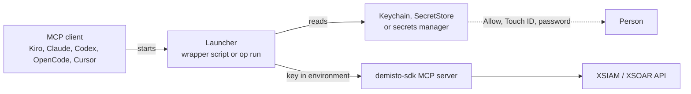

# Credentials Configuration

The `demisto-sdk` requires credentials to interact with your XSIAM/XSOAR instance.

Contents

- [Required environment variables](#required-environment-variables)
- [Where the values come from](#where-the-values-come-from)
- [Option 1: macOS Keychain](#option-1-macos-keychain)
- [Option 2: Windows SecretStore](#option-2-windows-secretstore)
- [Option 3: a secrets manager CLI](#option-3-a-secrets-manager-cli)
- [Linux](#linux)
- [CI encrypted secrets](#ci-encrypted-secrets)
- [Existing .env files](#existing-env-files)
- [Security considerations for remote operations](#security-considerations-for-remote-operations)

## Required environment variables

| Variable | Description |
|----------|-------------|
| `DEMISTO_BASE_URL` | Your XSIAM/XSOAR API URL |
| `DEMISTO_API_KEY` | API key with Instance Administrator role |
| `XSIAM_AUTH_ID` | Auth ID from the API key configuration |

> **Important:** Get the base URL from **Settings → Configurations → API Keys → Copy URL** (not the browser URL).

## Where the values come from

This is a workstation tool, the MCP client starts the server over stdio and the
server copies its environment into every `demisto-sdk` call. A launcher reads
the key from a store that asks the person, puts it in the server's environment,
and nothing else sees it.



Do not put the key in a `.env` file or in the client's config file. Both are
plaintext, readable by every process that runs as you, copied with the folder,
and one `git add` away from a public commit. The key carries Instance
Administrator rights, whoever holds it can read and change the tenant until it
is revoked. Type it at a hidden prompt, never on a command line, arguments show
in the process list and shell history. The base URL names your tenant, keep it
out of anything you publish.

Each option has two modes. Approval on every use is recommended, the store asks
the person each time the client starts the server. Approval for the MCP is the
pragmatic mode, the store releases the key silently while you are logged in and
the login password and screen lock are the gate. Choose per machine.

## Option 1: macOS Keychain

```bash
security add-generic-password -a "$USER" -s demisto-api-key \
  -l "XSIAM dev API key" -j "created 2026-11-05" -T "" -U -w
security add-generic-password -a "$USER" -s demisto-auth-id \
  -l "XSIAM dev API key id" -T "" -U -w
```

`security` prompts twice and does not echo. `-w` must be the last argument,
anything after it, including a keychain path, is stored as the password, so the
items go in the login keychain. `-U` updates an existing item, which is how you
rotate. Without `-w`, `security find-generic-password -a "$USER" -s
demisto-api-key` confirms an item exists without showing it. The base URL is
not a secret, set it in the client's `env` block.

Modes:

- Every use: `-T ""`, as above. Each read shows the dialog "security wants to
  use your confidential information", choose Allow. Always Allow switches the
  item to the second mode.
- For the MCP: `-T /usr/bin/security` in place of `-T ""`. Reads through the
  `security` tool need no dialog while the keychain is unlocked, and any script
  running as you can read the item the same way.

The launcher, saved outside the repository, `chmod +x`:

```sh
#!/bin/sh
# Starts the MCP server with the XSIAM key read from the login keychain.
set -eu
DEMISTO_API_KEY="$(security find-generic-password -a "$USER" -s demisto-api-key -w)"
XSIAM_AUTH_ID="$(security find-generic-password -a "$USER" -s demisto-auth-id -w)"
export DEMISTO_API_KEY XSIAM_AUTH_ID
exec /path/to/cortex-xsiam-sdk-mcp-tools/.venv/bin/python -m mcp_demisto_sdk
```

The dialog is graphical, so it appears when a desktop client starts the server.
Register the script as the client's command, see [MCP_CLIENTS.md](MCP_CLIENTS.md).

## Option 2: Windows SecretStore

Credential Manager's `cmdkey` can write a secret but not read one back, and
`cmdkey /pass:` puts the key in the process list and history. Use Microsoft's
[SecretManagement](https://learn.microsoft.com/en-us/powershell/utility-modules/secretmanagement/overview)
and [SecretStore](https://learn.microsoft.com/en-us/powershell/utility-modules/secretmanagement/how-to/manage-secretstore)
modules, an encrypted per-user store, in PowerShell 7.

```powershell
Install-Module Microsoft.PowerShell.SecretManagement, Microsoft.PowerShell.SecretStore -Scope CurrentUser
Register-SecretVault -Name Xsiam -ModuleName Microsoft.PowerShell.SecretStore -DefaultVault
Set-Secret -Name DemistoApiKey -Secret (Read-Host -AsSecureString 'XSIAM API key')
Set-Secret -Name XsiamAuthId -Secret (Read-Host -AsSecureString 'XSIAM auth id')
```

The first command that touches the store asks you to choose its password.
`Read-Host -AsSecureString` hides the input, `Get-SecretInfo` lists names
without values.

Modes:

- Every use: `Set-SecretStoreConfiguration -Authentication Password
  -Interaction Prompt -PasswordTimeout 60`. The store asks for its password
  when it has been locked for a minute. The prompt is console only, so this
  mode works from a terminal. A desktop client has no console, `Get-Secret`
  then fails with `PasswordRequiredException`, and `Unlock-SecretStore` in
  another window does not help because the unlock is per session.
- For the MCP: `Set-SecretStoreConfiguration -Authentication None -Interaction
  None`. No prompt, the store key sits in your profile protected by your
  Windows logon. This is the mode for Claude Desktop, Kiro or Cursor on Windows
  without a secrets manager.

The launcher, `run-mcp.ps1`, registered as `pwsh -NoProfile -File run-mcp.ps1`:

```powershell
$ErrorActionPreference = 'Stop'
$env:DEMISTO_API_KEY = Get-Secret -Name DemistoApiKey -AsPlainText
$env:XSIAM_AUTH_ID = Get-Secret -Name XsiamAuthId -AsPlainText
& C:\path\to\cortex-xsiam-sdk-mcp-tools\.venv\Scripts\python.exe -m mcp_demisto_sdk
```

## Option 3: a secrets manager CLI

A secrets manager CLI resolves references at start and passes the values to one
child process, nothing is written to disk, and the manager's own unlock is the
approval. 1Password CLI is the example here. Bitwarden Secrets Manager
(`bws run`), Doppler (`doppler run`), Infisical (`infisical run`) and HashiCorp
Vault Agent follow the same pattern, a run command, a reference file and an
unlock prompt or token. Use the one your organisation already runs.

[1Password CLI](https://developer.1password.com/docs/cli/) with the
[desktop app integration](https://developer.1password.com/docs/cli/app-integration/)
unlocks the way the app does, Touch ID, Windows Hello or the account password,
and `op` waits while the app is locked.

Store the key as an API Credential item in a vault shared only with the people
who use it, e.g. `XSIAM dev tenant`, key in `credential`, text fields `auth_id`
and `url`. From a terminal, read it at a hidden prompt:

```bash
stty -echo; printf 'XSIAM API key: '; read -r KEY; stty echo; printf '\n'
printf '%s' "$KEY" | jq -Rs \
  --arg title "XSIAM dev tenant" \
  --arg url "https://api-your-tenant.xdr.au.paloaltonetworks.com" \
  --arg id "12" \
  '{title: $title, category: "API_CREDENTIAL", fields: [
     {id: "credential", type: "CONCEALED", label: "credential", value: .},
     {id: "auth_id", type: "STRING", label: "auth_id", value: $id},
     {id: "url", type: "STRING", label: "url", value: $url}]}' \
  | op item create --vault "Security Engineering" - --format json \
  | jq -r '"stored \(.vault.name)/\(.id)"'
unset KEY
```

Copy `.env.op.example` to `.env.op` (git ignores it) and edit. Titles repeat,
so in a shared file use the item id, `op item get "<title>" --format json | jq -r .id`.

```bash
DEMISTO_BASE_URL=op://Security Engineering/XSIAM dev tenant/url
DEMISTO_API_KEY=op://Security Engineering/XSIAM dev tenant/credential
XSIAM_AUTH_ID=op://Security Engineering/XSIAM dev tenant/auth_id
```

Run:

```bash
op run --env-file=/path/to/cortex-xsiam-sdk-mcp-tools/.env.op -- \
  /path/to/cortex-xsiam-sdk-mcp-tools/.venv/bin/python -m mcp_demisto_sdk
```

In a client, `op` is the command and the rest are the arguments, see
[MCP_CLIENTS.md](MCP_CLIENTS.md). Desktop apps start with a short `PATH`, use
the full path to `op` (`/opt/homebrew/bin/op`, `/usr/local/bin/op`,
`C:\Program Files\1Password CLI\op.exe`).

Modes:

- Every use: a short auto-lock in the 1Password app (Settings, Security). `op`
  prompts whenever the app is locked, so each server start prompts.
- For the MCP: a longer auto-lock, one approval lasts until the app locks. The
  prompt is graphical on Windows too, so this option works from desktop clients
  where Option 2 cannot prompt.

Notes:

- `op run` masks every resolved value in the output, so a short auth id such as
  `12` disappears wherever those digits appear. If that corrupts output, set
  `XSIAM_AUTH_ID` in the client's `env` block, it is an identifier. Do not use
  `--no-masking`, it also unmasks the key.
- A locked app blocks until someone approves, wrap scripted runs in `timeout`.
- No `op read` into a terminal and no `--reveal`, transcripts are stored.

## Linux

`secret-tool` (libsecret) stores items in GNOME Keyring or KWallet and prompts
for the value in a terminal. The keyring unlocks with your login session and
does not prompt per read, so this is the "for the MCP" mode only. 1Password CLI
runs on Linux and prompts through the system authentication dialog.

```bash
secret-tool store --label="XSIAM dev API key" service demisto-api-key account "$USER"
secret-tool store --label="XSIAM dev auth id" service demisto-auth-id account "$USER"
export DEMISTO_API_KEY="$(secret-tool lookup service demisto-api-key account "$USER")"
export XSIAM_AUTH_ID="$(secret-tool lookup service demisto-auth-id account "$USER")"
```

## CI encrypted secrets

Most CI systems provide an encrypted secret store. For GitHub Actions, see the
[encrypted secrets documentation](https://docs.github.com/en/actions/security-guides/encrypted-secrets).

```yaml
env:
  DEMISTO_BASE_URL: ${{ secrets.DEMISTO_BASE_URL }}
  DEMISTO_API_KEY: ${{ secrets.DEMISTO_API_KEY }}
  XSIAM_AUTH_ID: ${{ secrets.XSIAM_AUTH_ID }}
```

## Existing .env files

This server never reads `.env` itself, `source .env` puts the values into your
shell for the rest of the session where every command can see them. If you
keep one anyway, git already ignores `.env` so do not force-add it, `chmod 600
.env`, commit placeholders only, and check with `git ls-files | grep '^\.env'`
that only `.env.op.example` is tracked.

## Security Considerations for Remote Operations

### Production-Impacting Tools

The following tools can modify your XSIAM/XSOAR tenant and should be used with caution:

| Tool | Risk Level | What It Does |
|------|------------|--------------|
| `upload_content` | **HIGH** | Deploys content to your tenant - can overwrite existing content |
| `run_command` | **HIGH** | Executes commands directly on your tenant |
| `run_playbook` | **HIGH** | Triggers playbook automation |
| `download_content` | LOW | Downloads content from tenant (read-only) |
| `list_files` | LOW | Lists available content (read-only) |

### Recommendations

1. **Use separate credentials for development and production**
   - Create a dedicated API key for development with limited scope
   - Never use production credentials during content development

2. **Test in staging first**
   - Deploy and test content in a non-production environment
   - Validate behavior before production deployment

3. **Review before upload**
   - Always review generated or modified content before uploading
   - Use `validate_content` and `lint_content` before deployment

4. **Enable audit logging**
   - Configure audit logging in your XSIAM tenant
   - Monitor for unexpected API activity

5. **Principle of least privilege**
   - Request only the API permissions you need
   - Avoid using Instance Administrator keys for routine operations

### SSL Verification

SSL certificate verification is enabled by default for all remote operations. This protects your credentials from man-in-the-middle attacks.

**Do not disable SSL verification (`insecure` flag) unless:**
- You are using a self-signed certificate in a controlled environment
- You understand and accept the security risks
- You have set `acknowledge_insecure_risk: true` explicitly

If you need to use self-signed certificates, consider:
1. Adding the CA certificate to your system trust store
2. Setting `REQUESTS_CA_BUNDLE` to point to your certificate
3. Using a proper certificate from a trusted CA
